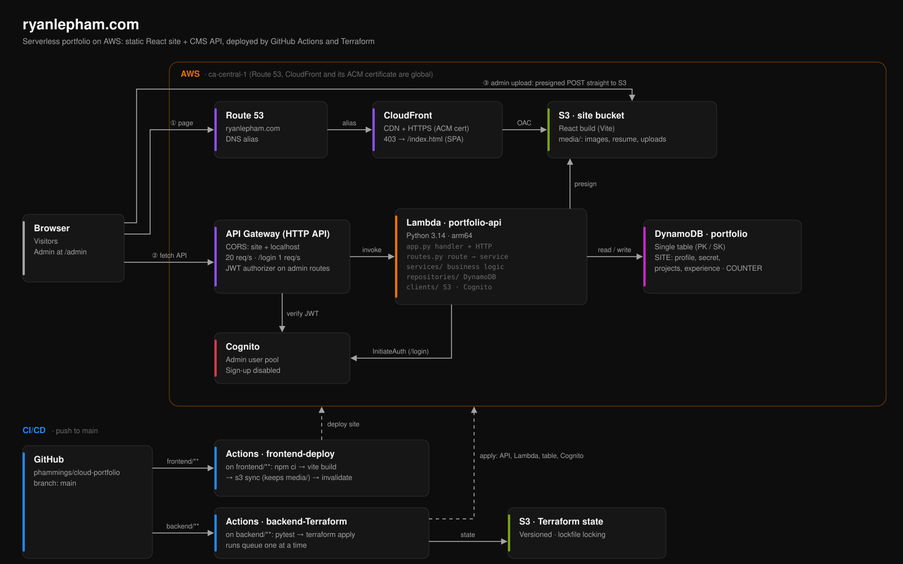

# AWS Cloud Resume Challenge
<a name="readme-top"></a>
<!-- PROJECT LOGO -->
<br />
<div align="center">

<h3 align="center">AWS Cloud Resume Challenge</h3>

  <p align="center">
    My take on the <a href="https://cloudresumechallenge.dev/">Cloud Resume Challenge</a>, a multi-step project by Forrest Brazeal for building and demonstrating the fundamentals of a career in cloud.
    It started as a React resume site with a visitor counter, and has grown into a serverless portfolio with its own CMS: a TypeScript frontend on S3 and CloudFront, a layered Python API on Lambda and DynamoDB, Cognito-protected admin, and everything deployed by GitHub Actions and Terraform.
    <br />
    <a href="https://www.ryanlepham.com/"><strong>Live site »</strong></a>
    ·
    <a href="https://www.ryanlepham.com/api-docs.html">API docs</a>
    ·
    <a href="#architecture">Architecture</a>
  </p>
</div>


<!-- TABLE OF CONTENTS -->
<details>
  <summary>Table of Contents</summary>
  <ol>
    <li>
      <a href="#about-the-project">About The Project</a>
      <ul>
        <li><a href="#features">Features</a></li>
        <li><a href="#built-with">Built With</a></li>
      </ul>
    </li>
    <li><a href="#roadmap">Roadmap</a></li>
    <li>
      <a href="#architecture">Architecture Diagram</a>
      <ul>
        <li><a href="#how-a-request-flows">How a request flows</a></li>
        <li><a href="#data-model">Data model</a></li>
        <li><a href="#api">API</a></li>
        <li><a href="#backend-layers">Backend layers</a></li>
        <li><a href="#cicd">CI/CD</a></li>
        <li><a href="#security">Security</a></li>
      </ul>
    </li>
    <li><a href="#repository-structure">Repository Structure</a></li>
    <li><a href="#getting-started">Getting Started</a></li>
    <li><a href="#lessons-learned">Lessons Learned</a></li>
  </ol>
</details>


<!-- ABOUT THE PROJECT -->
## About The Project

The Cloud Resume Challenge asks for a resume website hosted on AWS with a visitor counter backed by a serverless API, infrastructure as code and CI/CD. This repository is my submission, and it has kept growing past the original checklist.

The site is a static React app served from S3 through CloudFront on my own domain. Every piece of content on it (profile, projects, work experience, resume PDF) lives in DynamoDB and S3 and is edited through a password-protected admin page, so updating the site never requires a code change or a redeploy. The backend is a single Python Lambda behind API Gateway, structured in layers (routes, services, repositories) the way a larger service would be.

Both halves deploy automatically: pushing to `main` builds and uploads the frontend, and runs the backend's tests before applying the Terraform that defines every AWS resource.

## [Live Demo 🔗](https://www.ryanlepham.com/)

<p align="right">(<a href="#readme-top">back to top</a>)</p>


### Features

- **Visitor counter**: every landing-page visit increments an atomic DynamoDB counter, shown on the hero.
- **Built-in CMS**: `/admin` signs in through Cognito and creates, edits, reorders and deletes projects and experience, edits the profile, and uploads images and the resume directly to S3.
- **Safe uploads**: browsers upload straight to S3 with short-lived presigned POSTs. S3 itself enforces the file type and the 10 MB limit, and images are downscaled and stripped of metadata (such as GPS location) in the browser first.
- **API reference**: the OpenAPI spec is rendered with Redoc at [`/api-docs.html`](https://www.ryanlepham.com/api-docs.html).
- **Easter egg**: click the logo three times.

<p align="right">(<a href="#readme-top">back to top</a>)</p>


### Built With

* [![React][React]][React-url]
* [![TypeScript][TypeScript]][TypeScript-url]
* [![Vite][Vite]][Vite-url]
* [![Tailwind CSS][Tailwind CSS]][Tailwind CSS-url]
* [![Python][Python.py]][Python-url]
* [![S3][S3]][S3-url]
* [![AWS CloudFront][AWS CloudFront]][AWS CloudFront-url]
* [![Route53][Route53]][Route53-url]
* [![Certificate Manager][Certificate Manager]][Certificate Manager-url]
* [![API Gateway][API Gateway]][API Gateway-url]
* [![AWS Lambda][AWS Lambda]][AWS Lambda-url]
* [![DynamoDB][DynamoDB]][DynamoDB-url]
* [![Cognito][Cognito]][Cognito-url]
* [![GitHub Actions][GitHub Actions]][GitHub Actions-url]
* [![Terraform][Terraform]][Terraform-url]

<p align="right">(<a href="#readme-top">back to top</a>)</p>

<!-- ROADMAP -->
## Roadmap

**The original challenge**

- ✔️ Create a static React website for your portfolio
- ✔️ Ensure the S3 website URL uses HTTPS with Amazon CloudFront
- ✔️ Point a custom DNS domain name to the CloudFront distribution using Amazon Route 53
- ✔️ Implement a visitor counter on the webpage with useEffect
- ✔️ Store and update the visitor count in Amazon DynamoDB
- ✔️ Create an API with AWS API Gateway and Lambda for DynamoDB interaction
- ✔️ Define API resources in an AWS SAM template for easy deployment
- ✔️ Write Python code for the Lambda function using boto3 and pytest
- ✔️ Set up GitHub Actions for SAM application deployment
- ✔️ Set up Github Actions to update the S3 bucket automatically for frontend changes
- ✔️ Set up Github Actions to update the backend automatically for backend changes
- ✔️ Use Terraform for managing AWS resources and infrastructure as code

**The rehaul** (the staged plan is in [`docs/rehaul-plan.md`](docs/rehaul-plan.md))

- ✔️ Store Terraform state in S3 with locking, so CI no longer re-imports resources on every run
- ✔️ Replace the counter table with a single-table DynamoDB design for all site content
- ✔️ Make the visitor counter atomic (DynamoDB `ADD` instead of read-then-write)
- ✔️ Add Cognito authentication and JWT-protected admin routes to the API
- ✔️ Rebuild the frontend with Vite, React 19, TypeScript and Tailwind CSS, built in CI instead of committed
- ✔️ Build the admin CMS, with presigned S3 uploads
- ✔️ Upgrade the Lambda to Python 3.14 on arm64 (Graviton)
- ✔️ Split the Lambda into app, routes, services, repositories and clients layers, with tests per layer
- ✔️ Publish an OpenAPI spec and Redoc API reference
- ⬜ Reorder projects in one DynamoDB transaction (today a reorder is two separate writes)
- ⬜ Narrow the CI user's IAM permissions to only what Terraform manages
- ⬜ Bring CloudFront, the site bucket and Route 53 under Terraform (they were created by hand)

<p align="right">(<a href="#readme-top">back to top</a>)</p>


<!-- DIAGRAM -->
## Architecture


### How a request flows

1. **Loading the site.** Route 53 resolves `ryanlepham.com` to CloudFront, which serves the React build from a private S3 bucket over HTTPS (ACM certificate). Only CloudFront can read the bucket (Origin Access Control). Because the app routes in the browser, a request for a path like `/projects/airbnb-clone` has no matching file, so CloudFront's 403 error response returns `index.html` and React Router renders the page.
2. **Calling the API.** The app fetches all content in one `GET /content` call and counts the visit with `POST /views`. API Gateway checks CORS and rate limits, then invokes the Lambda, which reads or writes DynamoDB.
3. **Uploading media.** The admin asks the API for a presigned POST, then sends the file straight to S3. The file never passes through the Lambda, and its key (e.g. `media/<uuid>/resume.pdf`) is saved on the item. CloudFront serves uploads from the same domain as the site.

### Data model

One DynamoDB table, `portfolio`, holds everything, keyed by a partition key (`PK`) and sort key (`SK`):

| PK | SK | Item |
|---|---|---|
| `SITE` | `PROFILE` | name, tagline, about, socials, resume key |
| `SITE` | `SECRET` | the easter-egg slideshow's images |
| `SITE` | `PROJECT#<slug>` | one project |
| `SITE` | `EXPERIENCE#<slug>` | one role |
| `COUNTER` | `VIEWS` | the visitor count |

Putting all content under `PK=SITE` means the whole site loads with a single `Query`, with no scans and no joins. The counter sits in its own partition so a visit never touches content items. Lists are ordered by an `order` attribute rather than by the sort key, so reordering never has to rewrite keys. Point-in-time recovery is enabled, since this table is the only copy of the content.

### API

| Method | Route | Access | Purpose |
|---|---|---|---|
| `GET` | `/content` | public | Profile, projects, experience and slideshow in one response |
| `POST` | `/views` | public | Atomically increment and return the visitor count |
| `POST` | `/login` | public, 1 req/s | Exchange email and password for a Cognito access token |
| `PUT` | `/items/{type}/{id}` | admin | Create or replace a profile, project, experience or slideshow item |
| `DELETE` | `/items/{type}/{id}` | admin | Delete an item |
| `POST` | `/uploads` | admin | Presigned S3 POST for a PDF or image |

Admin routes need `Authorization: Bearer <accessToken>`. API Gateway's JWT authorizer validates the token against Cognito before the Lambda runs. The full reference, with schemas and examples, is at [ryanlepham.com/api-docs.html](https://www.ryanlepham.com/api-docs.html), generated from [`docs/openapi.json`](docs/openapi.json).

### Backend layers

The Lambda lives in [`backend/app/v1/portfolio_api/`](backend/app/v1/portfolio_api), with one folder per Lambda, and each layer has a single job:

| Layer | Responsibility |
|---|---|
| `app.py` | API Gateway entry point: parses the event, dispatches the route, turns results and errors into HTTP responses |
| `routes.py` | Every endpoint in one table: `"GET /content"` → `content_service.get_content` |
| `services/` | Business logic only: no boto3, no HTTP |
| `repositories/` | DynamoDB only, one single-item (atomic) request per function |
| `clients/` | S3 presigning and Cognito login, translating AWS errors into domain errors |
| `models/` | The key layout and validation rules, plus domain errors (`BadRequest` → 400, …) |

A service raises a domain error such as `BadRequest`, and `app.py` maps it to the HTTP status. The layers can be tested in isolation: 29 unit tests mock the layer below.

### CI/CD

| Workflow | Runs when | Steps |
|---|---|---|
| `frontend-deploy` | `frontend/**` or the API spec changes on `main` | `npm ci` → `vite build` → `aws s3 sync` (never deleting `media/`) → CloudFront invalidation |
| `backend-Terraform` | `backend/**` changes on `main` | `pytest` → `terraform plan` → `terraform apply` |

Terraform state lives in a versioned S3 bucket with lockfile locking, and backend runs queue one at a time so two applies can never fight over the lock. Hashed JS and CSS files are cached for a year, while `index.html` is never cached, so a deploy is visible immediately.

### Security

- **Secrets stay out of the repo.** AWS credentials live in GitHub Secrets. The frontend's `.env` holds only the public API URL. The Cognito admin user was created outside Terraform, so its password never reaches the state file.
- **Least privilege.** The Lambda's role can only use the `portfolio` table and write under `media/`. The site bucket is private, readable only by CloudFront.
- **Locked-down admin.** Cognito self sign-up is off, `/login` gives the same answer for an unknown email and a wrong password, and it has its own rate limit on top of Cognito's lockout.
- **Validated input.** Item types, ids and body sizes are checked in the API. Uploads are limited to PDF and raster images (no SVG, which can carry scripts). Third-party scripts are pinned with Subresource Integrity.

<p align="right">(<a href="#readme-top">back to top</a>)</p>


<!-- REPOSITORY STRUCTURE -->
## Repository Structure

```
├── frontend/                     React app (Vite + TypeScript + Tailwind)
│   ├── src/pages/                public pages
│   ├── src/admin/                /admin CMS (lazy-loaded)
│   ├── src/components/           layout, wave background, slideshow
│   └── public/api-docs.html      Redoc API reference
├── backend/
│   ├── app/v1/portfolio_api/     the Lambda: app.py, routes.py, services/, repositories/, clients/, models/, tests/
│   └── terraform/                API Gateway, Lambda, DynamoDB, Cognito, IAM (state in S3)
├── docs/
│   ├── openapi.json              API spec (single source of truth for the docs)
│   └── rehaul-plan.md            staged plan and design notes for the rebuild
├── img/architecture.svg          the diagram above
└── .github/workflows/            frontend-deploy and backend-Terraform
```

<p align="right">(<a href="#readme-top">back to top</a>)</p>


<!-- GETTING STARTED -->
## Getting Started

**Frontend** (Node 24): from the repo root

```sh
npm start                          # installs if needed, then runs Vite with hot reload on http://localhost:5173
npm run build                      # production build to frontend/dist
```

The dev server talks to the live API. Keep port 5173: it's the only local origin the API's CORS allows.

**Backend** (Python 3.14):

```sh
pip install boto3 pytest
pytest backend                     # all layers; a single test: pytest backend -k login
```

**Infrastructure**:

```sh
cd backend/terraform
terraform init && terraform plan   # needs AWS credentials; applies normally run from CI
```

**API docs**: lint the spec with `npx @redocly/cli lint docs/openapi.json`. `npm start` serves the rendered docs at `http://localhost:5173/api-docs.html`.

<p align="right">(<a href="#readme-top">back to top</a>)</p>


<!-- LESSONS LEARNED -->
## Lessons Learned

- **Terraform needs somewhere to remember.** Without remote state, every CI run starts with an empty record of what exists. The old pipeline papered over that by re-importing resources before each apply. Moving state to S3 removed the workaround entirely.
- **Read-then-write counters lose visits.** Two visitors arriving together both read the same number. DynamoDB's `ADD` does the increment server-side in one atomic request.
- **Design the table around the reads.** Grouping all content under one partition key turned "load the site" into a single query, which mattered more than modelling each type separately.
- **Let S3 enforce upload rules.** A presigned POST (unlike a presigned PUT) lets S3 reject the wrong file type or size itself, and keeps large files off the Lambda.
- **`s3 sync --delete` deletes everything it doesn't know about.** That includes user uploads, so `media/` has to be excluded explicitly.
- **Layers make a small Lambda easier to change.** Splitting HTTP handling, business rules and data access made each piece testable on its own, and made the route table the one place to look.

<p align="right">(<a href="#readme-top">back to top</a>)</p>


[React]: https://img.shields.io/badge/react-%2320232a.svg?style=for-the-badge&logo=react&logoColor=%2361DAFB
[React-url]: https://react.dev/
[TypeScript]: https://img.shields.io/badge/typescript-%23007ACC.svg?style=for-the-badge&logo=typescript&logoColor=white
[TypeScript-url]: https://www.typescriptlang.org/
[Vite]: https://img.shields.io/badge/vite-%23646CFF.svg?style=for-the-badge&logo=vite&logoColor=white
[Vite-url]: https://vite.dev/
[Tailwind CSS]: https://img.shields.io/badge/tailwindcss-%2338B2AC.svg?style=for-the-badge&logo=tailwind-css&logoColor=white
[Tailwind CSS-url]: https://tailwindcss.com/
[Python.py]: https://img.shields.io/badge/python-3670A0?style=for-the-badge&logo=python&logoColor=ffdd54
[Python-url]: https://www.python.org/
[S3]: https://img.shields.io/badge/S3-569A31?style=for-the-badge
[S3-url]: https://aws.amazon.com/s3/
[AWS CloudFront]: https://img.shields.io/badge/AWS%20CloudFront-8C4FFF?style=for-the-badge
[AWS CloudFront-url]: https://aws.amazon.com/cloudfront/
[Route53]: https://img.shields.io/badge/Amazon%20Route%2053-8C4FFF?style=for-the-badge
[Route53-url]: https://aws.amazon.com/route53/
[Certificate Manager]: https://img.shields.io/badge/Certificate%20Manager-232F3E?style=for-the-badge
[Certificate Manager-url]: https://aws.amazon.com/certificate-manager/
[API Gateway]: https://img.shields.io/badge/API%20Gateway-8C4FFF?style=for-the-badge
[API Gateway-url]: https://aws.amazon.com/api-gateway/
[AWS Lambda]: https://img.shields.io/badge/AWS%20Lambda-ED7100?style=for-the-badge
[AWS Lambda-url]: https://aws.amazon.com/lambda/
[DynamoDB]: https://img.shields.io/badge/DynamoDB-4053D6?style=for-the-badge
[DynamoDB-url]: https://aws.amazon.com/dynamodb/
[Cognito]: https://img.shields.io/badge/Amazon%20Cognito-DD344C?style=for-the-badge
[Cognito-url]: https://aws.amazon.com/cognito/
[GitHub Actions]: https://img.shields.io/badge/GitHub%20Actions-2088FF?style=for-the-badge&logo=github-actions&logoColor=white
[GitHub Actions-url]: https://github.com/features/actions
[Terraform]: https://img.shields.io/badge/Terraform-623CE4?style=for-the-badge&logo=terraform&logoColor=white
[Terraform-url]: https://www.terraform.io/
